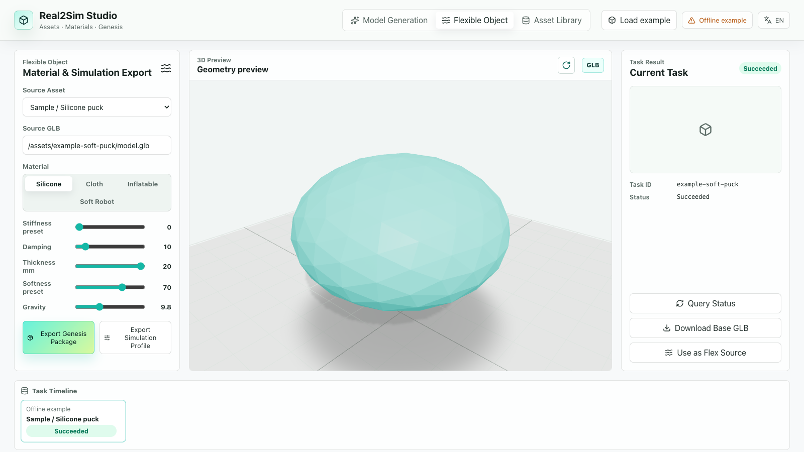

# Real2Sim Studio

一个本地优先的 3D 资产与 Genesis 仿真导出工作台。

[English](../README.md) | [示例复现](../examples/README.md) | [路线图](ROADMAP.md)



[下载 Alpha 发布包](https://github.com/eust-w/real2sim-platform/releases/tag/v0.1.0-alpha.1) | [90 秒介绍视频](https://github.com/eust-w/real2sim-platform/releases/download/v0.1.0-alpha.1/real2sim-intro-zh.mp4) | [45 秒竖版](https://github.com/eust-w/real2sim-platform/releases/download/v0.1.0-alpha.1/real2sim-short-zh.mp4) | [Gitea 镜像](https://gitea.d-robotics.cc/longtao.wu/real2sim-platform)

预览 GLB、配置材料预设，并导出包含网格、参数和 Python 脚本的 Genesis 场景包。内置自制样例不需要 API Key；可选接入自己的 DashScope 账号，通过 Tripo 生成 3D 资产。

## 无需密钥体验

需要 Node.js 22.12 或更新版本。

```bash
git clone https://github.com/eust-w/real2sim-platform.git
cd real2sim-platform
npm ci
npm run demo
```

打开终端打印的本地网址，点击“加载示例”，调整材料参数，再导出 Genesis 包。演示模式不读取 `.env.local` 中的服务密钥，禁止付费生成调用，并使用独立的 `.data/demo/` 数据目录。

## 运行真实仿真

```bash
npm run example:export
python3.11 -m venv .venv
source .venv/bin/activate
pip install -r examples/requirements.txt
python .data/genesis-packages/example-soft-puck/genesis_scene.py --steps 800 --record
```

首次启动需要编译求解器。无 `--record` 时不请求相机，输出数值指标与轨迹；添加 `--record` 输出实际 Genesis 求解画面。详细环境与注意事项见[示例文档](../examples/README.md)。

**Alpha 安全限制：**可选 Python 依赖链中的 Pillow 存在已知漏洞，上游 MoviePy 的版本约束尚未兼容修复版本。仅在隔离环境中运行可信样例，不要处理外来模型或图片，详见[审计说明](../SECURITY.md)。Node 审计通过不代表 Python 环境无漏洞。

## 已有功能

- 文本、单图、多图生成接口，可选使用用户自己的 DashScope / Tripo 服务。
- 本地任务历史、资产缓存、GLB 预览和模型下载。
- 自制且可按 MIT 许可再分发的离线样例。
- 根据当前滑杆导出材料预设、重力、网格和 Genesis 运行脚本。
- FEM 弹性体导出，以及实验性的 PBD 布料导出路径。
- 中英文界面、单元测试、后端类型检查与桌面/移动端浏览器测试。

## 边界与费用

浏览器是几何预览，不执行物理求解。材料参数是示意预设，不是从真实物体测得的参数。样例是程序化网格，不是扫描重建结果。布料路径没有被这个实体样例验证；充气体和软体机器人预设也不包含压力或执行器模型。

本项目不承诺任意网格都能仿真，不宣称已实现机器人训练、场景重建或经过测量的 sim-to-real 精度。生成式柔性变体是新的提示词生成，并非对原 GLB 的物理变形。

工作台代码和自制样例采用 MIT 许可。外部模型、服务及生成资产另受提供方条款约束，开源工作台不代表底层生成模型开源或生成免费。详见[第三方声明](../THIRD_PARTY_NOTICES.md)。

连接生成服务时，复制 `.env.example` 为 `.env.local` 并设置自己的 Key，然后运行 `npm run dev`。API 只监听 `127.0.0.1:8789`，本项目不是可直接公开部署的多用户服务。不要把密钥或 `.data/` 提交到 Git。

## 开发与反馈

```bash
npm run test:run
npm run lint
npm run build
npx playwright install chromium
npm run test:e2e
npm audit
```

欢迎提交可复现的问题、安装日志和独立复现结果。请阅读[贡献指南](../CONTRIBUTING.md)与[安全说明](../SECURITY.md)，不要在 Issue 中包含密钥或私人模型。
